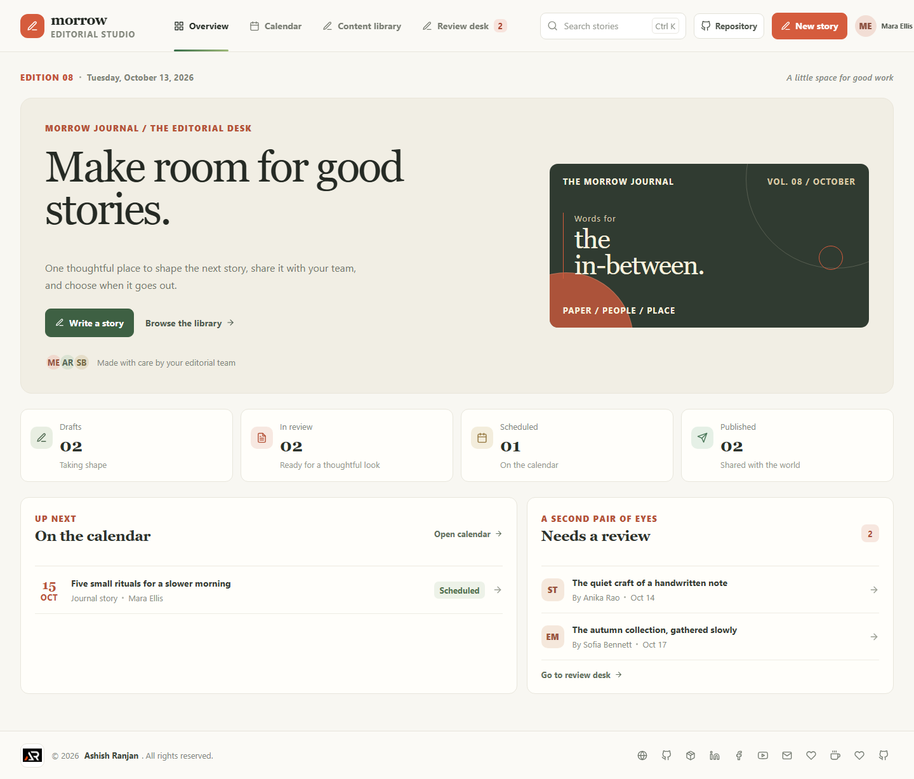

# Morrow | Editorial Studio

Morrow is a frontend-only editorial workspace for planning, writing, reviewing, and scheduling content. Its editorial dashboard, weekly calendar, content library, and review desk share the same in-memory story data.

- **Live demo:** [a2rp.github.io/content-management-system](https://a2rp.github.io/content-management-system/)
- **Source repository:** [github.com/a2rp/content-management-system](https://github.com/a2rp/content-management-system)

## What is included

- **Overview:** Draft, review, scheduled, and published counts are calculated from the story records. The page also links to upcoming content and the review queue.
- **Publishing calendar:** Browse a week or agenda, move between weeks, return to the current week, open a story, or start a story on a selected day. The selected date is carried into the editor.
- **Content library:** Search by headline, summary, owner, or ID. Filter by workflow status and content type, sort by date or title, export the current view as CSV, open details, edit a story, change its status, or remove it.
- **Review desk:** Read stories in the review queue, request a revision with a note, revisit requested changes, edit the story, or approve it into the publishing calendar.
- **Story editor:** Create and update headlines, summaries, content types, workflow status, owners, dates, and story text. Scheduled stories require a current or future date.
- **Feedback and safety:** Actions show clear toast feedback. Story details and forms use accessible dialogs, and story removal requires a confirmation dialog. Forms show inline validation messages.
- **Navigation:** Search from the header with `Ctrl K` or `Cmd K`. The header stays available at the top, hides while scrolling down, and returns while scrolling up. The mobile menu and search control remain usable on small screens.

## Demo data and limits

This project is a client-side UI demonstration. It has no connected backend, account system, or external publishing integration. Story data is held in React state only. Creating, editing, reviewing, scheduling, deleting, and exporting work in the current page session. Refreshing or closing the page resets the sample stories and any changes made during that visit. No browser storage is used.

## Run locally

```sh
npm install
npm run dev
```

The development server prints its local URL in the terminal.

## Quality and deployment

```sh
npm run lint
npm run build
npm run deploy
```

The deploy script builds the app, copies the SPA entry page to `dist/404.html`, and publishes `dist` to the `gh-pages` branch. GitHub Pages serves the app at [https://a2rp.github.io/content-management-system/](https://a2rp.github.io/content-management-system/).

## Screenshots

Screenshots below were captured from the local production build at a 1440 by 1000 viewport. They show the app pages and the main form, detail, validation, and confirmation dialogs.

### Pages

#### Editorial overview


Overview of the editorial workspace, including its current counts, scheduled stories, and review queue.

#### Publishing calendar

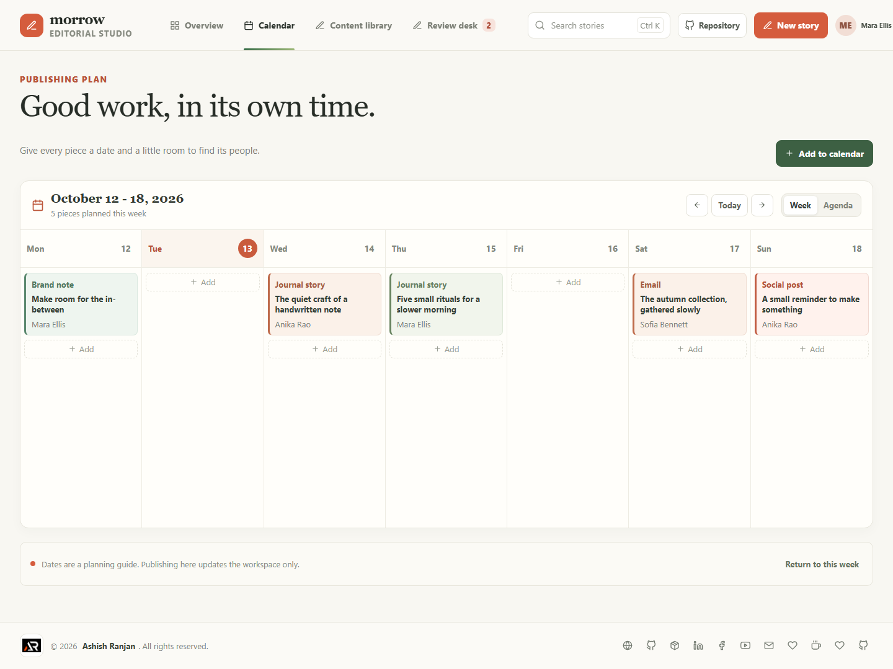

Weekly view with story cards, date navigation, and the agenda option.

#### Content library

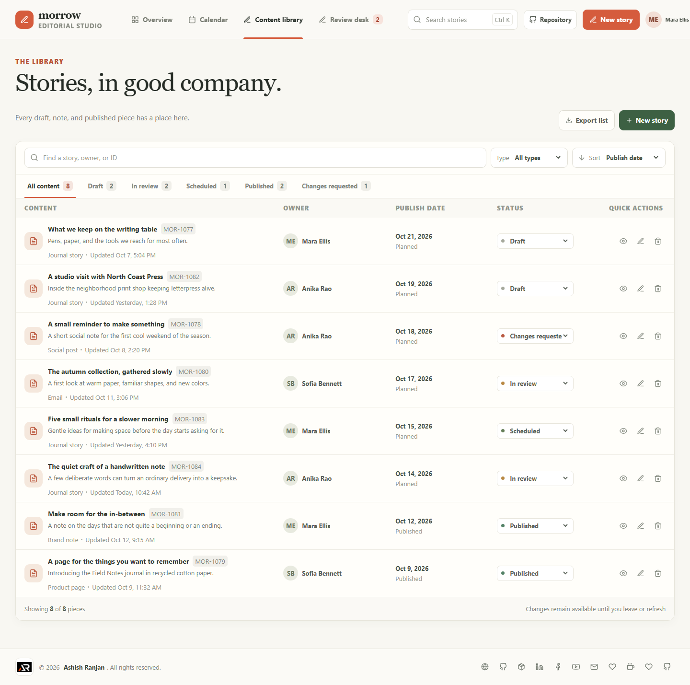

Story records with search, filters, sorting, export, status changes, and row actions.

#### Review desk

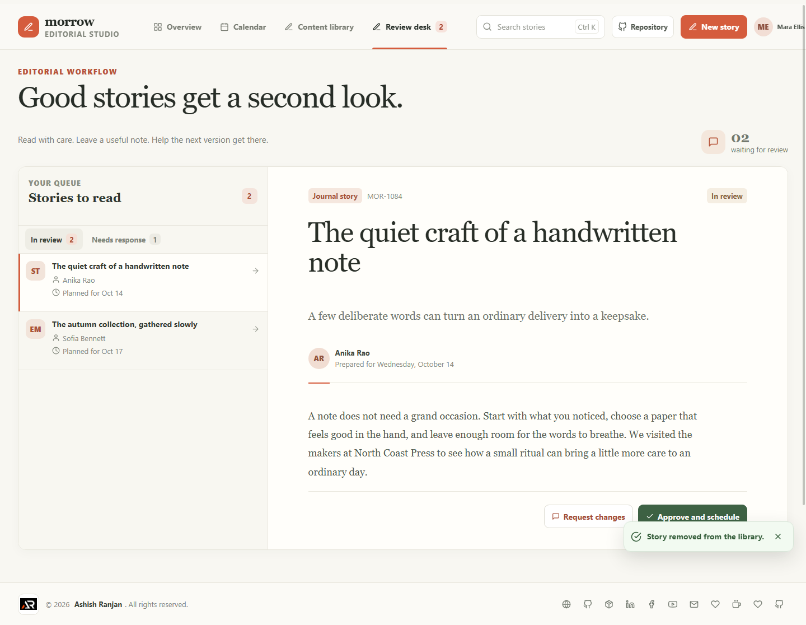

Read a queued story, request a revision, or approve it for scheduling.

### Dialogs and validation

#### New story

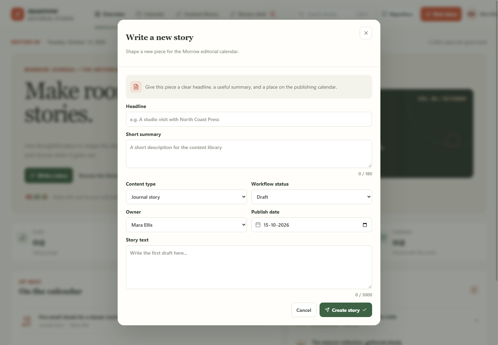

Create a story with its summary, type, owner, status, date, and full text.

#### Story details

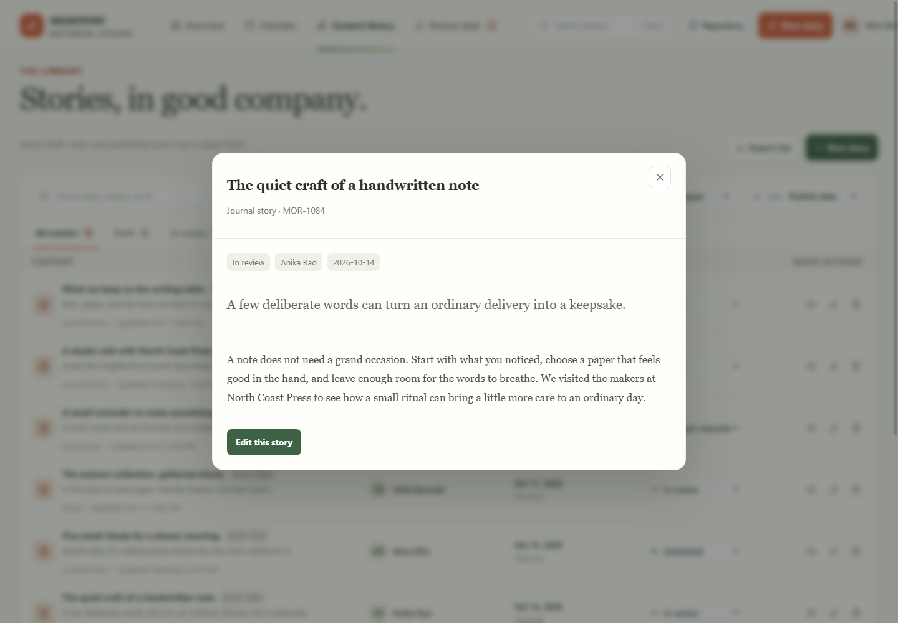

Review a story's status, author, date, summary, and full text.

#### Edit story

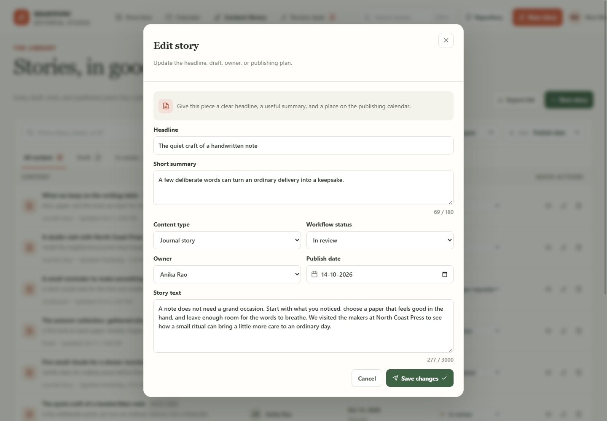

Update an existing story in the shared workspace state.

#### Story form validation

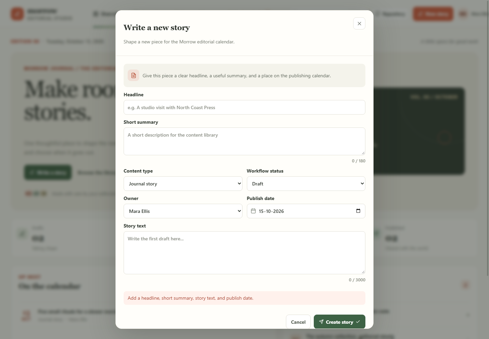

The editor explains which required story fields still need content.

#### Request changes

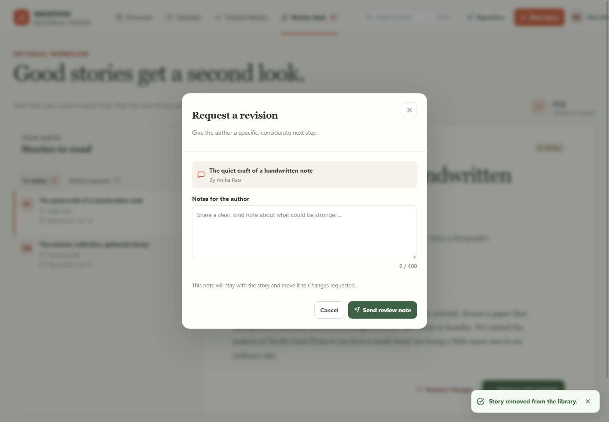

Write a specific note that moves the story to Changes requested.

#### Review note validation

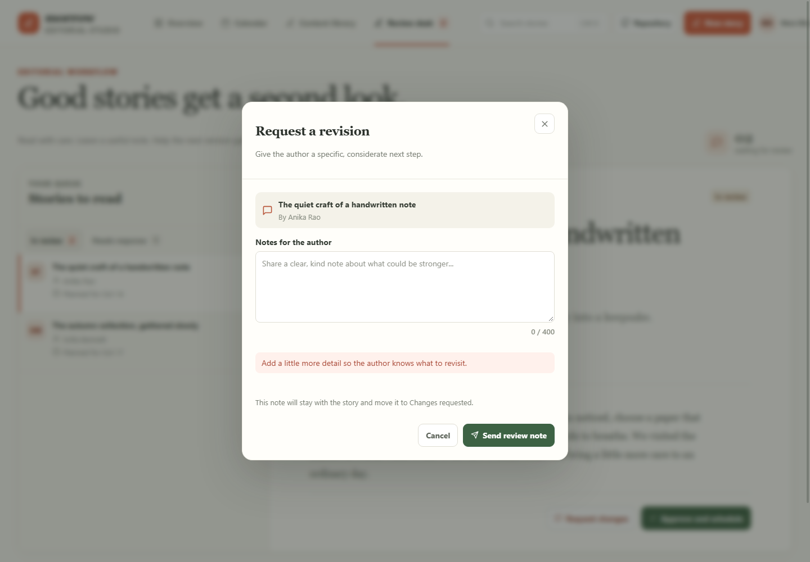

Review notes need enough detail to guide the next edit.

#### Delete confirmation

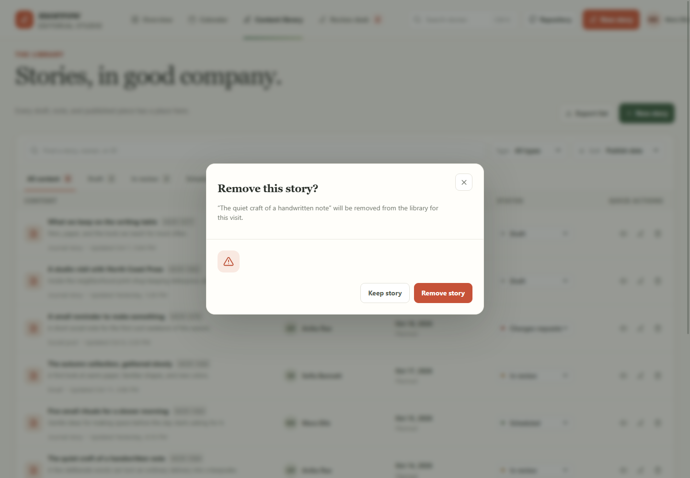

Removing a story asks for confirmation before updating the library.

## Future improvements

These ideas need shared services or production integrations and are not implemented:

- Add team accounts, permissions, and shared server-side story storage.
- Connect approved content to publishing tools for websites, email, and social channels.
- Add hosted media management, asset version history, and secure file storage.
- Record a server-side audit history and send review notifications between team members.

## Links

- Portfolio: [https://www.ashishranjan.net](https://www.ashishranjan.net)
- GitHub: [https://github.com/a2rp](https://github.com/a2rp)
- CodePen: [https://codepen.io/ash1198](https://codepen.io/ash1198)
- LinkedIn: [https://www.linkedin.com/in/aashishranjan](https://www.linkedin.com/in/aashishranjan)
- Facebook: [https://www.facebook.com/theash.ashish/](https://www.facebook.com/theash.ashish/)
- YouTube: [https://www.youtube.com/@ashishranjan-ashz?sub_confirmation=1](https://www.youtube.com/@ashishranjan-ashz?sub_confirmation=1)
- Email: [mailto:ash.ranjan09@gmail.com](mailto:ash.ranjan09@gmail.com)

## Support

- Support: [https://a2rp-donation-page.netlify.app/](https://a2rp-donation-page.netlify.app/)
- Buy Me a Coffee: [https://buymeacoffee.com/ashishranjan](https://buymeacoffee.com/ashishranjan)
- Patreon: [https://www.patreon.com/ashishranjan](https://www.patreon.com/ashishranjan)
